# Corne (42-key, ZMK)

QWERTY with home row mods, six working thumbs, a LaTeX-first symbol layer and a
left-hand numpad. The picture above redraws itself on every push.

## Thumbs

| Key | Tap | Hold |
|---|---|---|
| Left outer | Esc | MEDIA |
| Left middle | Tab | MOUSE |
| Left inner | Space | NAV |
| Right inner | Enter | SYM |
| Right middle | Bksp | NUM |
| Right outer | Del | FUN |

Tap then hold quickly to auto-repeat (Bksp, Space).

## Home row mods

`A S D F` = Gui Alt Ctrl Shift, mirrored on `J K L ;`. Use the mod on the
**opposite** hand from the letter: Ctrl+C is hold `K`, tap `C`. Capital A is hold `J`, tap `A`.
Same-hand combos and mid-word rolls always type letters, by design.

## Machines (hold Del)

Top row on the right: **PC**, **Mac**, **ThinkPad**. Each one switches to its own
Bluetooth profile (0, 1, 2). Modifiers are the same on every machine, so on a Mac
Cmd is the Gui key (`A` / `;`).

## Flashing

1. Download the firmware zip from the latest Actions run (or let the sync helper do it).
2. Plug in the left half, double-tap its reset button, drag `corne_left-*.uf2` onto the drive.
3. Same for the right half with `corne_right-*.uf2`.
4. Open ZMK Studio and press **Restore stock settings** once so old Studio edits don't
   override this keymap. Studio locking is turned off in `build.yaml`, so no unlock is needed.

`settings_reset` wipes Bluetooth pairings too. Only use it if a half won't pair.

## Editing

Edit `config/corne.keymap`. The sync helper (`tools/keymap_sync.pyw`) pops up
after you save and offers: save to this branch, save as an experiment branch, or merge
into main. First-time setup: `powershell -ExecutionPolicy Bypass -File tools\setup.ps1`.
